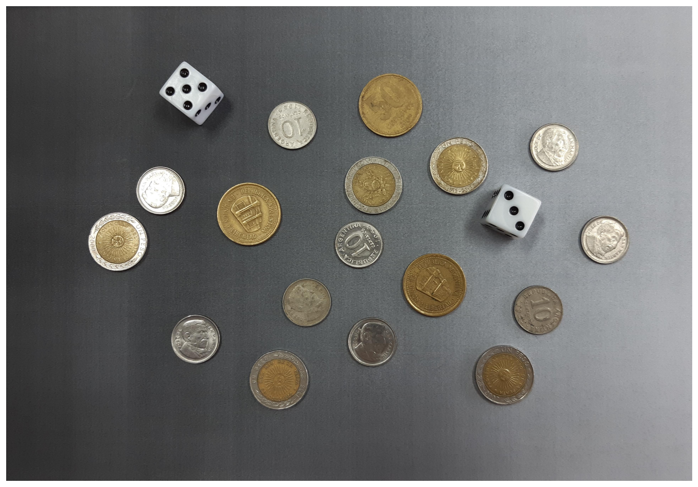
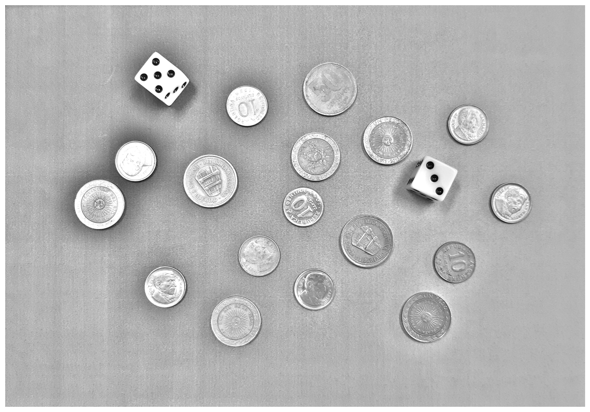
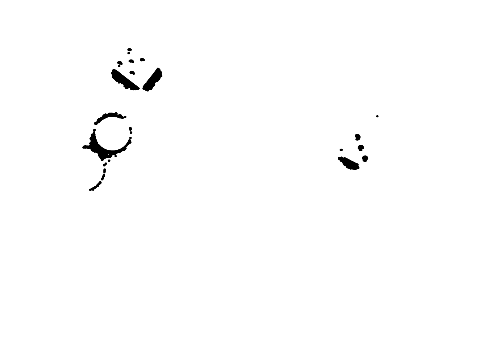
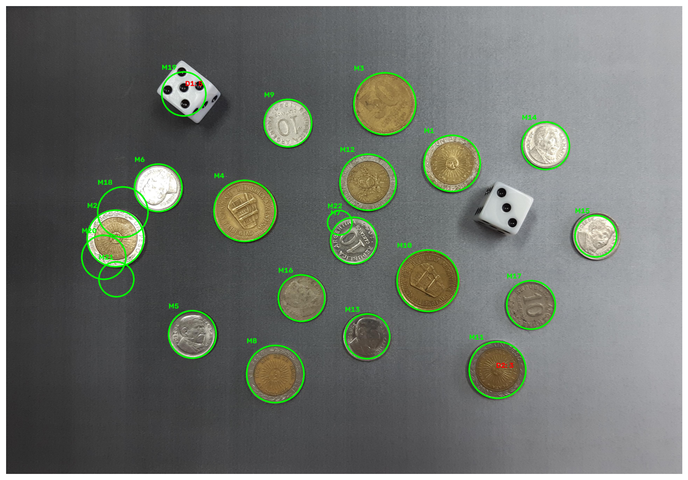

## Problema 1: Detección y clasificación de monedas y dados

### Descripción y segmentación

La imagen tiene iluminación no uniforme. Se pasa a grises y se estima el fondo con un filtro gaussiano (desviación 91 px). La división por el fondo corrige el gradiente; después se umbraliza y se limpia la máscara con cierre y apertura morfológica.

### Clasificación y conteo

Los bordes circulares se detectan mediante la transformada de Hough, más estable que un umbral único para monedas plateadas, doradas y bimetálicas. Cada círculo aporta su radio; los radios se agrupan por proximidad para contar los tipos. Los dados se distinguen por su contorno no circular y sus puntos oscuros: las caras superiores tienen cinco y tres puntos.

### Conclusión

La corrección de iluminación evita depender de la intensidad absoluta del tapete, y Hough aporta una medida geométrica directa del tamaño. Para objetos solapados, una mejora posible sería combinar el método con watershed.

## Problema 2: Detección y segmentación de patentes

### Detección de la placa

Se umbralizan las zonas oscuras de cada imagen y se aplican cierre y dilatación con elementos rectangulares horizontales. Los contornos candidatos se filtran por área, relación ancho/alto y posición; el puntaje favorece el rectángulo con componentes claras internas y relación de aspecto de patente.

### Segmentación de caracteres

Se elimina el margen de la placa, se binarizan las letras claras y se buscan componentes conectadas. Se retienen las de área intermedia y relación alto/ancho entre 1,2 y 4,2, consistente con la pista de la cátedra (1,5 a 3). Las componentes se ordenan de izquierda a derecha; las máscaras, recortes y cajas se guardan para la primera mitad del conjunto: `img01.png` a `img06.png`.

### Dificultades y conclusión

Rejillas, paragolpes y sombras introducen rectángulos oscuros parecidos a una matrícula, por lo que se combinan forma, ubicación y estructura interna. Los parámetros se expresan como proporciones del recorte para tolerar cambios de escala. En una colección mayor, convendría rectificar la perspectiva antes de segmentar y validar el patrón de dos grupos de tres caracteres.
