## Problema 1: Detección y clasificación de monedas y dados

### Descripción del problema

La imagen `monedas.jpg` muestra monedas de distinto valor y tamaño y dos dados sobre un tapete de intensidad no uniforme. La consigna pide:

- **A)** Segmentar automáticamente las monedas y los dados.
- **B)** Clasificar los distintos tipos de monedas y contarlas.
- **C)** Determinar el valor de la cara superior de cada dado y contarlos.

La solución está en `src/problema1_monedas_dados.py`. El script recorre las etapas en orden, en una sección por etapa: análisis del fondo, intento con top-hat, bordes, máscara, monedas y dados, tipos de moneda, valor de los dados y resultado. En cada una imprime sus resultados, muestra la figura en pantalla y la guarda en `resultados/problema1/`. Usa dos funciones de la cátedra: `imshow`, de la Unidad 3, con los mismos cambios que en el TP1, e `imfillhole`, la versión con `cv2.floodFill` del rellenado de huecos de la Unidad 6. La única función propia es `contar_regiones`, que cuenta las regiones de una máscara con `cv2.connectedComponents`.

### Análisis de la imagen

Antes de segmentar, el script mide el nivel de gris del tapete en los bordes izquierdo y derecho de la imagen, donde no hay objetos, y prueba un umbral global con el método de Otsu (Unidad 3), que elige el umbral que mejor separa el histograma en dos grupos:

```text
Tamaño: 3871 x 2681 píxeles
Gris medio de las 100 columnas de la izquierda: 52
Gris medio de las 100 columnas de la derecha: 171
Umbral de Otsu sobre toda la imagen: 115
```

El tapete pasa de un gris medio de 52 a la izquierda a 171 a la derecha. Por eso el histograma de la Figura 1 tiene dos picos, que no corresponden al fondo y a los objetos sino a las dos mitades del tapete. Otsu pone el umbral entre ellos, en 115, y la máscara resultante separa la mitad derecha del tapete de la izquierda. Además, las monedas de la derecha quedan más oscuras que su fondo: en la máscara se ven negras sobre blanco.


Un umbral único no sirve, porque el mismo nivel de gris es fondo de un lado de la imagen y moneda del otro.

### Intento con top-hat

Para estos casos, el apunte de la Unidad 6 propone obtener un fondo uniforme con la transformación top-hat: restarle a la imagen su apertura con un elemento estructural más grande que los objetos. La apertura es una erosión seguida de una dilatación. La erosión reemplaza cada píxel por el mínimo de los píxeles que cubre el elemento, así que borra los objetos claros en los que el elemento entra entero, y la dilatación devuelve su tamaño a lo que sobrevivió, que es el fondo. El apunte de la Unidad 3 usa la misma idea como umbral local.

Se usó una elipse de 401×401 píxeles, más grande que la moneda más grande: su área, de 103 016 píxeles según la tabla de la sección 1.6, equivale a un círculo de unos 362 píxeles de diámetro. Después, el top-hat se umbraliza con Otsu y se rellenan los huecos:

```text
Top-hat: umbral de Otsu 72, 5763 regiones
Top-hat: la región más grande tiene 1065620 píxeles
```

En esta imagen el top-hat no alcanza, por dos motivos que se ven en la Figura 2. El primero es que el fondo estimado no es suave: donde las monedas están cerca, la elipse no entra entre ellas sin tocar zonas más oscuras, y la apertura queda por debajo del tapete real. El centro del tapete conserva brillo en el top-hat y, al umbralizar, se une con las monedas: la región más grande mide 1 065 620 píxeles, diez veces una moneda grande. El segundo es que el top-hat solo resalta lo que es más claro que el fondo, y las monedas más oscuras que el tapete, como las de la derecha, quedan marcadas apenas por su borde.


El problema no es solo el gradiente del fondo: hay monedas con un nivel de gris parecido al del tapete que las rodea. Lo que las separa siempre es el borde, así que la segmentación se hizo a partir de los bordes.

### Bordes

Como en los ejemplos de la Unidad 3, primero se suaviza la imagen con un filtro gaussiano, de desvío 2, para que el ruido no genere bordes, y después se aplica Canny con `cv2.Canny(suavizada, 20, 60)`. Canny calcula el gradiente, se queda con los máximos locales en la dirección del gradiente y aplica dos umbrales (histéresis): un píxel con gradiente mayor a 60 es borde; uno entre 20 y 60 es borde solo si está conectado a un píxel de borde; y uno menor a 20 se descarta. Como responde a los cambios locales de intensidad y no al nivel absoluto, el gradiente lento del tapete no genera bordes.

La textura del tapete, en cambio, sí genera muchos tramos cortos. Cada tramo de borde es una componente conectada de la imagen de Canny, y `cv2.connectedComponentsWithStats` da su cantidad de píxeles en `stats[i, cv2.CC_STAT_AREA]`, que para una línea de un píxel de ancho es su largo. Se conservan los tramos de 50 píxeles o más: el script arma la lista de sus etiquetas y `np.isin(etiquetas, tramos_largos)` marca los píxeles que pertenecen a alguno de ellos.

```text
Canny: 3586 tramos de borde, 936 de 50 píxeles o más
```

La Figura 3 muestra el efecto en la zona central, donde el tapete tiene más textura: los contornos de las monedas y los dados se mantienen y desaparecen los tramos sueltos del tapete. Si se dejaran, la dilatación del paso siguiente los engordaría y podrían unir monedas vecinas.


### Máscara de los objetos

Los contornos de Canny tienen cortes, así que no se pueden rellenar directamente. La Figura 5 lo muestra en la moneda 2: aunque su borde parece completo, el relleno sin dilatar no completa nada, porque el fondo se cuela por algún corte y lo inunda todo. Por eso se aplica la secuencia siguiente, con las operaciones de la Unidad 6:

1. Dilatación con una elipse de 35×35 (`cv2.dilate`). Cada píxel toma el máximo de los píxeles que cubre la elipse, así que los bordes engordan unos 17 píxeles hacia cada lado y se cierran los cortes de hasta unos 34 píxeles.
2. Relleno de huecos con `imfillhole`. La función inunda el fondo con `cv2.floodFill` desde la esquina (0, 0): todo lo que está conectado con el borde de la imagen sin cruzar un píxel blanco queda inundado. Lo que no se inunda está encerrado por un contorno, y se agrega a la máscara.
3. Erosión con la misma elipse (`cv2.erode`). Cada píxel toma el mínimo, así que los objetos vuelven al tamaño que tenían antes de la dilatación. Dilatar y después erosionar con el mismo elemento es una clausura; acá el relleno va en el medio.
4. Apertura con una elipse de 41×41 (`cv2.morphologyEx` con `cv2.MORPH_OPEN`), que elimina las regiones en las que la elipse no entra y alisa el borde de los objetos.

El script cuenta las regiones después de cada paso:

```text
Regiones después de la dilatación: 26
Regiones después del relleno: 23
Regiones después de la erosión: 23
Regiones después de la apertura: 19
```

El relleno baja de 26 a 23 regiones porque algunas quedaban dentro de una moneda, como los trazos del relieve engordados por la dilatación, y pasan a formar parte de ella (Figura 5, abajo a la izquierda). La apertura elimina las cuatro regiones chicas que quedan, y así queda una región por objeto: 19.


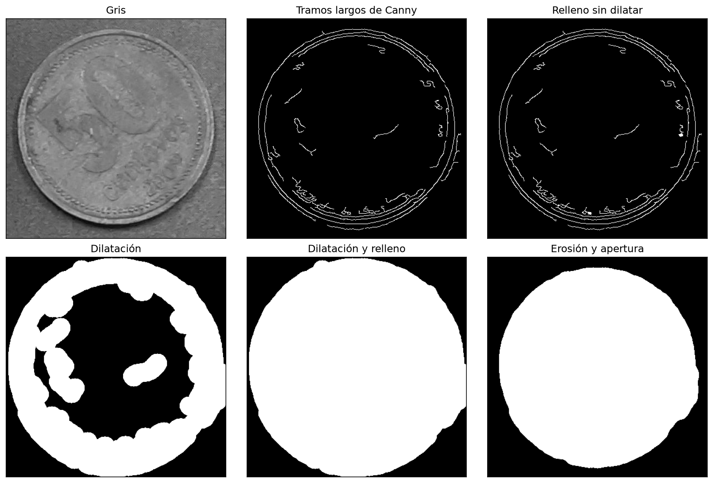

Los umbrales de Canny y los tamaños de los elementos estructurales se eligieron probando sobre la imagen. Con umbrales más altos o un elemento de cierre más chico, algunos contornos quedan abiertos y el relleno no completa la moneda; con un elemento de cierre más grande, se unen monedas vecinas.

### Monedas y dados (ítem A)

Para separar monedas de dados se usa el factor de forma de la pista de la cátedra, área sobre perímetro al cuadrado, multiplicado por $4\pi$ para que un círculo dé 1:

$$
\rho = \frac{4 \pi A}{P^2}
$$

Un círculo de radio $r$ tiene $A = \pi r^2$ y $P = 2 \pi r$, y da $\rho = 1$. Un cuadrado de lado $L$ tiene $A = L^2$ y $P = 4L$, y da $\rho = \pi / 4$. El script imprime los dos valores:

```text
Factor de forma de un círculo: 1.000
Factor de forma de un cuadrado: 0.785
```

Para cada objeto, `cv2.findContours` con `cv2.RETR_EXTERNAL` da su contorno exterior, `cv2.contourArea` su área y `cv2.arcLength` su perímetro. Los objetos se numeran de arriba hacia abajo:

```text
Objeto  Área (px)  Rho    Clase
     1      72020  0.778  dado
     2     103016  0.876  moneda
     3      59954  0.881  moneda
     4      61522  0.868  moneda
     5      87700  0.861  moneda
     6      84432  0.875  moneda
     7      58230  0.896  moneda
     8      62638  0.720  dado
     9     102796  0.866  moneda
    10      60859  0.873  moneda
    11      86090  0.892  moneda
    12      58726  0.850  moneda
    13     101714  0.842  moneda
    14      60166  0.886  moneda
    15      61962  0.859  moneda
    16      60479  0.885  moneda
    17      58434  0.885  moneda
    18      87098  0.832  moneda
    19      87332  0.890  moneda
Monedas: 17, dados: 2
```

Los dados dan 0,778 y 0,720, cerca del valor del cuadrado (0,785). El dado 8 queda más abajo porque su máscara incluye parte de una cara lateral y su borde es más irregular (Figura 6). Las monedas dan entre 0,832 y 0,896, y ninguna llega a 1 por dos motivos: el contorno sigue el borde de los píxeles en escalones, así que `cv2.arcLength` mide un perímetro más largo que el de la circunferencia real, y el borde de la máscara tiene pequeñas irregularidades (Figura 5). Con el rango de 0,9 a 1,1 que se propuso en clase para los círculos, todas las monedas quedarían como no circulares. Por eso el umbral se eligió con los valores medidos: un objeto con $\rho < 0{,}8$ es un dado. Ese valor queda entre el dado de mayor $\rho$ y la moneda de menor $\rho$, y separa los 17 círculos de los 2 cuadrados.


La Figura 7 muestra el área y el factor de forma de cada objeto. Los dos dados quedan a la izquierda del umbral, y las monedas, a la derecha, en tres franjas de área bien separadas, que son los tipos de moneda del ítem siguiente.

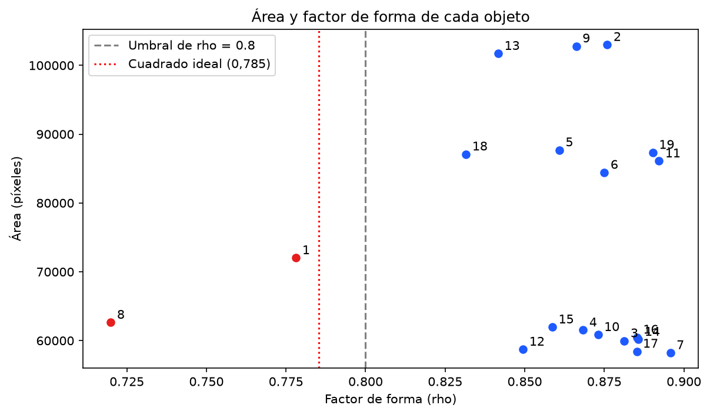

### Tipos de moneda (ítem B)

Las monedas de distinto valor tienen distinto tamaño, así que se clasifican por área. El script las ordena de menor a mayor y las recorre comparando cada una con la anterior: si es más de un 10 % mayor, empieza un tipo nuevo.

```text
Moneda  Área (px)  Área / anterior
     7      58230
    17      58434  1.004
    12      58726  1.005
     3      59954  1.021
    14      60166  1.004
    16      60479  1.005
    10      60859  1.006
     4      61522  1.011
    15      61962  1.007
     6      84432  1.363
    11      86090  1.020
    18      87098  1.012
    19      87332  1.003
     5      87700  1.004
    13     101714  1.160
     9     102796  1.011
     2     103016  1.002
```

Entre monedas consecutivas el área crece como mucho un 2,1 %, salvo en dos saltos: 36,3 % y 16,0 %. El criterio del 10 % queda entre los dos casos y arma tres grupos (Figura 8). El nombre de cada grupo sale de lo que se lee en sus monedas: «10 CENTAVOS» en las monedas 3, 12 y 15, «UN PESO» en las bimetálicas (por ejemplo, la 11) y un «50», gastado, en la moneda 2.

```text
Conteo de monedas:
  10 centavos: 9 (áreas de 58230 a 61962 px)
  1 peso: 5 (áreas de 84432 a 87700 px)
  50 centavos: 3 (áreas de 101714 a 103016 px)
```


### Valor de los dados (ítem C)

Los puntos de un dado son huecos oscuros dentro de su cara blanca, así que el valor sale de contar huecos. Para cada dado:

1. Se recorta su rectángulo envolvente (`cv2.boundingRect`) y se umbraliza el recorte con Otsu, que separa la cara blanca de lo oscuro.
2. Se conserva solo lo que está dentro de la máscara del dado, con `cv2.bitwise_and`, porque en el lado derecho de la imagen el tapete también supera el umbral.
3. Se buscan los contornos con `cv2.findContours` y `cv2.RETR_CCOMP`. Con este modo, OpenCV organiza los contornos en dos niveles: los bordes exteriores de las regiones blancas y, dentro de ellos, los bordes de sus huecos. Para cada contorno, `jerarquia[0][i]` tiene cuatro valores: el siguiente contorno del mismo nivel, el anterior, el primer hijo y el padre. Un contorno con padre, es decir, con el cuarto valor distinto de −1, es un hueco.
4. Se mide el área de cada hueco como fracción del área del dado.

```text
Dado 1: umbral de Otsu 125, 20 huecos
  Los 10 huecos más grandes, en % del área del dado:
  3.14, 3.10, 3.07, 3.07, 3.04, 1.26, 1.20, 1.16, 0.01, 0.01
  Valor: 5
Dado 8: umbral de Otsu 126, 4 huecos
  Los 10 huecos más grandes, en % del área del dado:
  3.88, 3.67, 3.61, 0.00
  Valor: 3
```

No todos los huecos son puntos de la cara superior. Los de la cara superior ocupan entre 3,04 % y 3,88 % del área del dado. Los de la cara lateral del dado 1 ocupan entre 1,16 % y 1,26 %: se ven de costado, achatados, y por eso ocupan menos de la mitad. En el dado 8, las caras laterales quedan oscuras en la binarización, así que sus puntos no forman huecos. El resto de los huecos, como mucho de 0,01 %, son reflejos y ruido de la binarización. Por eso se cuentan como puntos los huecos que ocupan más del 2 % del área del dado: el dado 1 vale 5 y el dado 8 vale 3 (Figura 9).

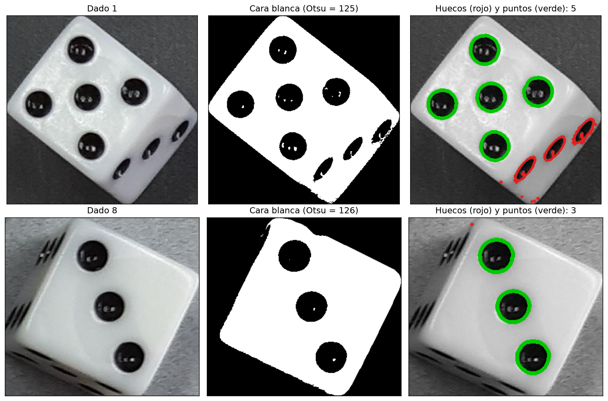

### Resultado y conclusiones

```text
Resultado: 17 monedas y 2 dados con valores 5, 3
```

La Figura 10 resume los tres ítems: 9 monedas de 10 centavos, 5 de 1 peso, 3 de 50 centavos, y dos dados que valen 5 y 3.


Las principales dificultades fueron tres. La primera, el fondo: su gradiente impide umbralar la imagen directamente, y el top-hat no lo resuelve en esta imagen porque las monedas están cerca entre sí y algunas son más oscuras que el tapete. La segunda, los contornos de Canny, que tienen cortes y hay que cerrarlos sin unir monedas vecinas. La tercera, los puntos de las caras laterales de los dados, que también son huecos y se distinguen por su área.

La segmentación por bordes resuelve el problema del fondo, porque los bordes no dependen del nivel de gris absoluto, y la morfología los convierte en una máscara con un objeto por moneda o dado. Con esa máscara, el factor de forma separa monedas de dados, y el área separa los tres tipos de moneda con saltos de al menos 16 %, contra un 2,1 % como máximo dentro de cada tipo. En los dados, el área de cada hueco distingue los puntos de la cara superior de los de las caras laterales.

Los umbrales de Canny y los elementos estructurales se ajustaron para esta imagen. Con otra escala o iluminación habría que revisarlos, aunque los criterios de clasificación (factor de forma, saltos de área y área relativa de los puntos) son proporciones y no dependen del tamaño de la imagen.

## Problema 2: Detección y segmentación de patentes

### Descripción del problema

Las doce imágenes `img01.png` a `img12.png`, de 640×360 píxeles, muestran la parte delantera o trasera de distintos vehículos con su patente. La consigna pide, para cada una:

- **A)** Detectar automáticamente la placa patente y segmentarla.
- **B)** Segmentar los caracteres de la placa detectada.

La solución está en `src/problema2_patentes.py`. Como propuso la cátedra al presentar el TP, primero busca los caracteres y después, a partir de ellos, la placa. El script primero muestra el detalle de cada paso con la imagen `img01.png` y después procesa las doce imágenes en un ciclo, con una figura por etapa. Muestra cada figura en pantalla y la guarda en `resultados/problema2/`.

El script se organiza en una función por paso. `binarizar` umbraliza la imagen en grises; `candidatos` busca las componentes con forma de carácter; `cadena_mas_larga` busca entre ellas la secuencia más larga de caracteres alineados; `separaciones` y `es_patente` verifican que la secuencia tenga dos grupos de tres; y `elegir_umbral` prueba todos los umbrales y elige uno. Con los caracteres, `rectangulo` y `agrandar` arman la caja de la placa, y `enderezar_placa` la rota para dejarla horizontal. `procesar` aplica todos esos pasos a una imagen. El resto de las funciones (`imshow`, de la Unidad 3, `zona_alrededor`, `dibujar_cajas`, `dibujar_recta_bases` y `curva_de_umbrales`) solo arman las figuras.

### Lo que se sabe de una patente

Las placas tienen caracteres blancos sobre fondo negro, rodeados por un marco blanco. La pista de la cátedra (`info_patentes.txt`) agrega tres datos, que son la base del método: la relación alto/ancho de un carácter está entre 1,5 y 3; los caracteres forman grupos de a 3; y la patente tiene dos grupos de 3 caracteres. En una imagen umbralizada hay cientos de componentes, pero pocas tienen forma de carácter, y casi nunca hay seis seguidas, alineadas y de la misma altura, salvo en la patente.

### Binarización

Para un umbral dado, `binarizar` pasa a blanco los píxeles de la imagen en grises que lo superan, con `cv2.threshold` y `cv2.THRESH_BINARY`. Los caracteres, que son claros, quedan blancos. Cómo se elige el umbral se explica en la sección 2.6; en la imagen 1 vale 165. Con ese umbral, la imagen binarizada tiene 648 componentes conectadas (Figura 11): los caracteres y el marco de la placa, pero también la vereda, los reflejos del capó, la caja de luz y muchas manchas de los adoquines.

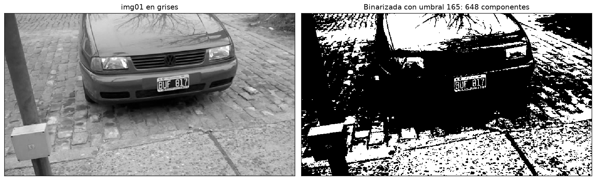

### Candidatos a carácter

`candidatos` busca las componentes con `cv2.connectedComponentsWithStats` (Unidad 3), que devuelve una fila por componente con su posición (x, y), su ancho, su alto y su área en píxeles. La fila 0 es el fondo y se saltea. Una componente es candidata a carácter si cumple tres filtros, que se aplican en este orden:

1. Alto entre 8 y 40 píxeles. Es un rango amplio alrededor de lo que miden los caracteres en estas imágenes: según la salida de la sección 2.9, su alto mediano va de 11 a 20 píxeles.
2. Relación alto/ancho entre 1,5 y 3, la de la pista.
3. Área de 15 píxeles o más, para descartar manchas sueltas.

La función devuelve las cajas (x, y, ancho, alto) de los candidatos ordenadas de izquierda a derecha, y cuántas componentes pasan cada filtro. En la imagen 1:

```text
Componentes de la imagen binarizada: 648
  con alto entre 8 y 40 píxeles: 64
  y además con alto/ancho entre 1.5 y 3.0: 12
  y además con área de 15 píxeles o más: 10 candidatos
```

De 648 componentes quedan 10 candidatos. El script los muestra con su caja, su relación alto/ancho y si forman parte de la cadena que se elige en la sección siguiente; la tabla reproduce esa salida:

| x | y | Ancho | Alto | Alto/ancho | En la cadena |
|--:|--:|--:|--:|--:|:--|
| 34 | 239 | 7 | 11 | 1,57 | |
| 50 | 106 | 4 | 10 | 2,50 | |
| 189 | 230 | 5 | 10 | 2,00 | |
| 340 | 152 | 8 | 16 | 2,00 | sí |
| 350 | 151 | 7 | 15 | 2,14 | sí |
| 359 | 150 | 7 | 15 | 2,14 | sí |
| 378 | 147 | 7 | 16 | 2,29 | sí |
| 387 | 146 | 7 | 15 | 2,14 | sí |
| 396 | 145 | 7 | 15 | 2,14 | sí |
| 544 | 117 | 5 | 8 | 1,60 | |

Seis candidatos son los caracteres de la patente. Los otros cuatro son manchas en otras partes de la imagen que, por casualidad, tienen forma de carácter (Figura 12, a la izquierda). Los filtros de forma no alcanzan solos, pero dejan pocos candidatos para el paso siguiente.

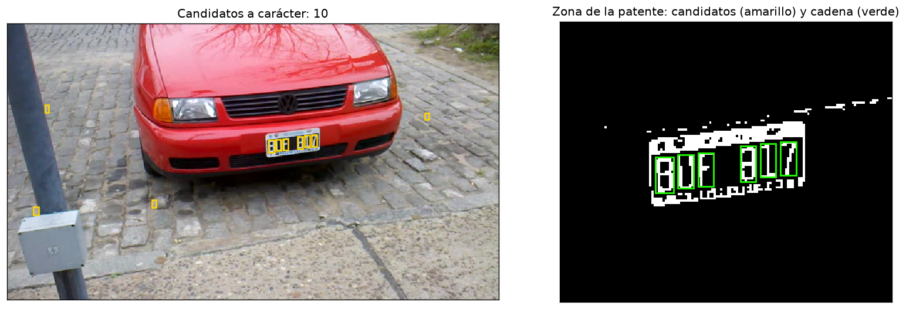

### Cadena de caracteres

`cadena_mas_larga` prueba cada candidato como primer carácter y recorre los siguientes hacia la derecha. Agrega un candidato a la cadena si cumple tres condiciones respecto del último agregado:

1. Alto parecido: su alto difiere del alto del primero de la cadena en menos del 30 %.
2. Alineado: su centro vertical está a menos de 0,4 altos del centro del anterior.
3. Cerca: empieza después de la mitad del anterior, y el espacio entre los dos es de 1,5 altos como mucho.

De todas las cadenas, se queda con la más larga. En la imagen 1, la cadena empieza en el candidato de x = 340, y con su alto quedan definidas las tolerancias:

```text
Cadena más larga: 6 caracteres
Alto del primero: 16 px; se aceptan altos de 11.2 a 20.8 px,
centros a 6.4 px como mucho y espacios de hasta 24.0 px
```

Para cada carácter de la cadena, el script muestra su alto, su centro vertical y el espacio con el anterior:

```text
Carácter  alto  centro vertical  espacio con el anterior
       1    16            160.0
       2    15            158.5  2
       3    15            157.5  2
       4    16            155.0  12
       5    15            153.5  2
       6    15            152.5  2
Patente válida (6 caracteres y el espacio mayor entre el 3.° y el 4.°): True
```

Los seis caracteres miden 15 o 16 píxeles de alto, dentro del rango de 11,2 a 20,8. El centro vertical baja de 160,0 a 152,5 porque la placa está inclinada: entre el primero y el último hay 7,5 píxeles, más que los 6,4 permitidos, pero entre dos caracteres seguidos la diferencia es de 2,5 como mucho. Por eso el centro se compara con el del carácter anterior y no con el del primero: así la cadena admite placas inclinadas. Los otros cuatro candidatos están lejos de la patente y no se suman a ninguna cadena larga.

Por último, `es_patente` verifica la pista de los dos grupos: la cadena tiene que tener 6 caracteres y el espacio más grande tiene que estar entre el tercero y el cuarto. En la imagen 1, los espacios son 2, 2, 12, 2 y 2 píxeles, y el de 12 separa «BUF» de «817».

### Elección del umbral

Un único umbral no alcanza. Con el de Otsu (Unidad 3), la cadena es una patente válida solo en 6 de las 12 imágenes (sección 2.9). En la imagen 1, Otsu da 114 y la cadena más larga tiene 4 caracteres:

```text
Umbrales que dan una patente válida: 8, de 145 a 180
Umbral de Otsu: 114, cadena más larga con ese umbral: 4
```

Por eso `elegir_umbral` prueba todos los umbrales de 40 a 230, de 5 en 5, y con cada uno busca la cadena más larga. La Figura 13 muestra el largo de esa cadena según el umbral en la imagen 1, y la binarización con tres umbrales:

- Con umbral 125, por debajo del rango, la «B» queda pegada al marco blanco de la placa y forman una sola componente, que no tiene forma de carácter. La cadena tiene 5 caracteres.
- Con umbral 165, el elegido, los seis caracteres quedan separados del marco y entre sí.
- Con umbral 200, por encima del rango, los trazos de los caracteres se cortan y ya no forman componentes con forma de carácter. La cadena tiene 1.

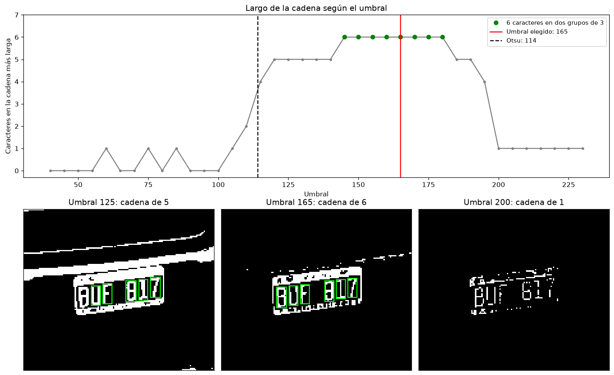

Entre los dos problemas hay un rango de umbrales, de 145 a 180 en la imagen 1, en el que la cadena es una patente válida. Se elige el umbral del medio de ese rango, el más alejado de los dos extremos. Si ningún umbral da una patente válida, se usa el del medio entre los que dan la cadena más larga.

### Placa (ítem A) y caracteres (ítem B)

Los caracteres de la cadena elegida son la segmentación del ítem B. La placa se obtiene a partir de ellos: `rectangulo` calcula el rectángulo que contiene a los seis caracteres, y `agrandar` lo agranda en proporción al alto mediano de los caracteres para incluir el marco y la inscripción superior. Se agranda 0,4 altos a cada lado, 0,8 arriba y 0,5 abajo; los márgenes se eligieron mirando las doce placas. Los bordes se redondean hacia abajo y se limitan al tamaño de la imagen. En la imagen 1:

```text
Rectángulo de los caracteres (x, y, ancho, alto): (340, 145, 63, 23)
Alto mediano de los caracteres: 15 píxeles
Márgenes: 6.0 píxeles a cada lado, 12.0 arriba y 7.5 abajo
Placa (x, y, ancho, alto): (334, 133, 75, 42)
```

El rectángulo de los caracteres va de x = 340 a 403 y de y = 145 a 168. Con los márgenes, la placa va de x = 334 a 409 y de y = 133 a 175: 75 por 42 píxeles. La caja no se rota para seguir la inclinación de la placa: al presentar el TP, la cátedra aclaró que no hace falta. La Figura 14, a la izquierda, muestra el rectángulo de los caracteres y la placa.

### Placa enderezada

Además, el script muestra cada placa enderezada. `enderezar_placa` estima la inclinación con la recta que mejor ajusta las bases de los caracteres: toma, para cada uno, el centro horizontal y la fila de su borde inferior, y ajusta una recta con `np.polyfit` (cuadrados mínimos). La pendiente de la recta es la tangente del ángulo:

```text
Recta de las bases: pendiente -0.139, inclinación -7.9°
```

En las imágenes, la fila crece hacia abajo, así que una pendiente negativa es una placa que sube hacia la derecha. Después, la imagen se rota ese ángulo alrededor del centro de la placa con `cv2.getRotationMatrix2D` y `cv2.warpAffine`, como en los ejemplos de transformaciones geométricas de la Unidad 4. Para OpenCV, un ángulo negativo es una rotación en sentido horario, que deja la placa horizontal. Por último, las esquinas de los caracteres se llevan a la imagen rotada con `cv2.transform` y la misma matriz, y la placa se recorta alrededor de ellas con los mismos márgenes que antes (Figura 14).

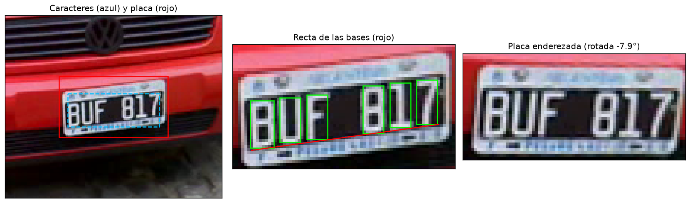

Enderezar la placa no cambia la detección, porque se hace después de encontrar los caracteres. La cadena, por su parte, ya admite placas inclinadas: en la sección siguiente, la imagen 4, la más inclinada, sale completa.

### Las doce imágenes

El script aplica los mismos pasos a las doce imágenes con la función `procesar`, y para cada una imprime:

```text
img01: 8 umbrales válidos, de 145 a 180; umbral elegido 165
  Otsu: umbral 114, cadena de 4 (no válida)
  Caracteres: 6, alto mediano 15 px, espacios (px): [2, 2, 12, 2, 2]
  Placa (x, y, ancho, alto): (334, 133, 75, 42), inclinación -7.9°
```

La tabla siguiente junta esas salidas para las doce imágenes. El alto mediano de los caracteres, que no está en la tabla, va de 11 píxeles en la imagen 12 a 20 en la imagen 6.

| Imagen | Umbrales válidos | Umbral elegido | Otsu (caracteres en la cadena) | Espacio entre grupos (px) | Inclinación |
|:--|:--|--:|:--|--:|--:|
| img01 | 8, de 145 a 180 | 165 | 114 (4) | 12 | −7,9° |
| img02 | 7, de 90 a 120 | 105 | 116 (6) | 9 | −9,7° |
| img03 | ninguno | 120 | 124 (5) | no aplica | −12,2° |
| img04 | 15, de 125 a 195 | 160 | 115 (2) | 10 | −14,1° |
| img05 | 17, de 110 a 190 | 150 | 118 (6) | 13 | −10,5° |
| img06 | 12, de 55 a 120 | 95 | 102 (6) | 13 | −7,9° |
| img07 | 10, de 75 a 120 | 100 | 107 (6) | 10 | 0,0° |
| img08 | 13, de 130 a 190 | 160 | 119 (2) | 10 | −8,3° |
| img09 | 9, de 80 a 120 | 100 | 134 (4) | 13 | −0,2° |
| img10 | 6, de 115 a 140 | 130 | 122 (6) | 12 | −3,6° |
| img11 | 4, de 135 a 150 | 145 | 112 (1) | 10 | −9,9° |
| img12 | 7, de 80 a 110 | 95 | 92 (6) | 8 | −5,3° |

Al final, el script imprime el resumen:

```text
Placas con los 6 caracteres segmentados: 11 de 12
Con un único umbral (Otsu) habrían sido: 6 de 12
```

El rango de umbrales válidos cambia mucho de una imagen a otra, porque cada foto tiene otra iluminación y otro contraste (Figura 15). El de la imagen 1 (145 a 180) y el de la imagen 2 (90 a 120) ni siquiera se tocan, así que no hay un umbral fijo que sirva para todas. En la imagen 6, los umbrales válidos no son continuos: hay 12 entre 55 y 120, con un hueco en el medio. En las 11 placas completas, el espacio entre los dos grupos mide entre 8 y 13 píxeles, y los espacios entre caracteres del mismo grupo, entre 0 y 5.

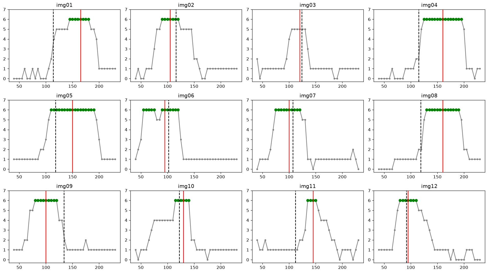

La Figura 16 muestra, con el umbral elegido, los candidatos y la cadena en la zona de cada patente; la Figura 17, la placa detectada en cada imagen (ítem A); la Figura 18, los caracteres segmentados en cada placa (ítem B), con la recta de sus bases; y la Figura 19, las placas enderezadas.

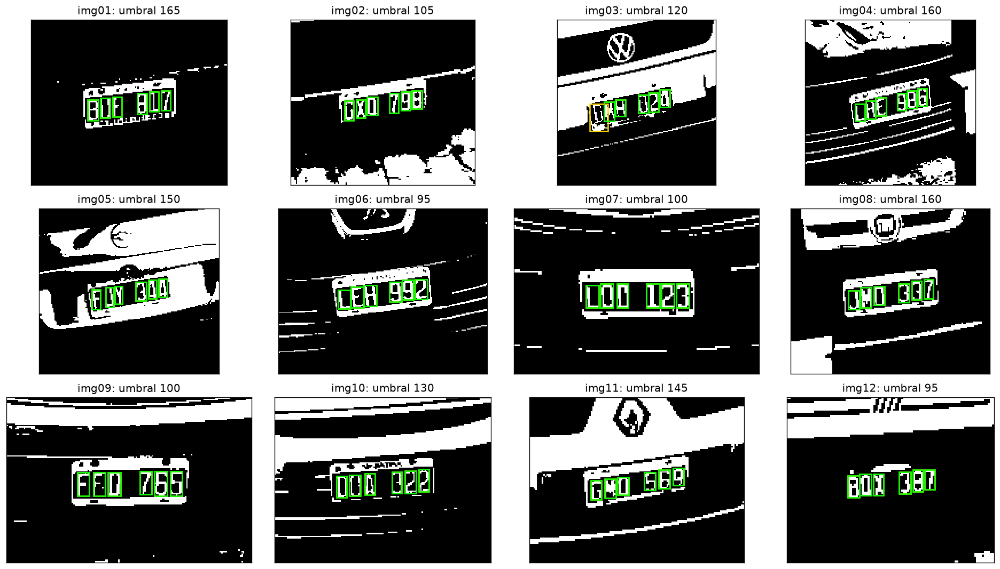

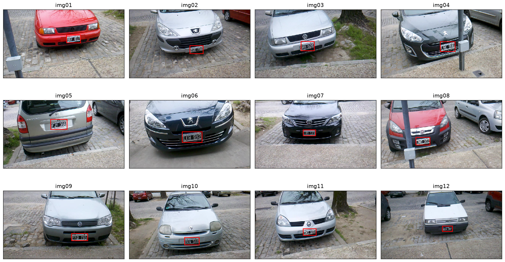

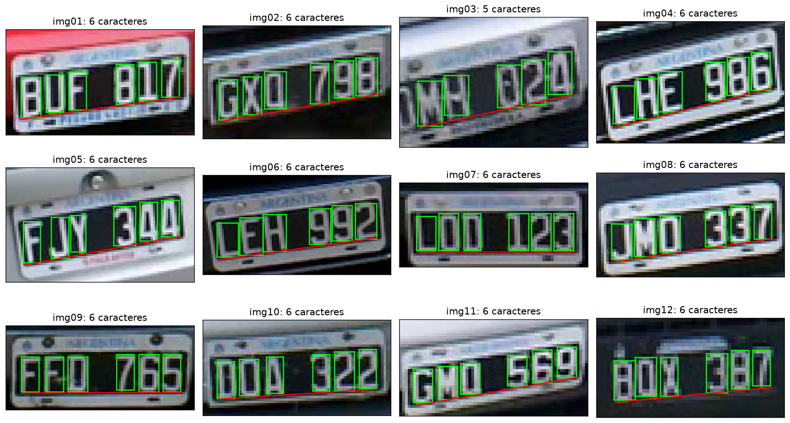

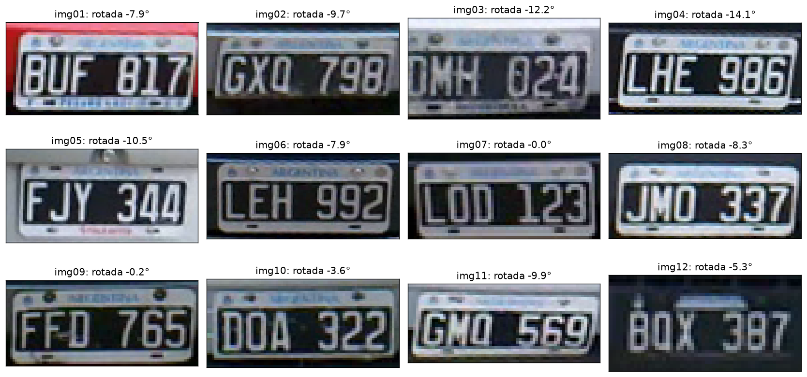

### La imagen 3

La imagen 3 es la única incompleta: se segmentan 5 caracteres y falta la «D». La placa está inclinada y la «D» toca el marco. Con el umbral elegido, las dos forman un solo candidato, en amarillo en la Figura 16, más alto que los demás caracteres, que queda fuera de la cadena por la condición de alto parecido. Con umbrales más altos, el trazo de la «D» se corta antes de separarse del marco, así que ningún umbral da 6 caracteres: la curva de la imagen 3 en la Figura 15 llega como mucho a 5. Como la placa se arma a partir de los caracteres, su caja deja afuera el extremo izquierdo.

### Dificultades y conclusiones

Las principales dificultades fueron cuatro. La primera, el umbral: cada imagen tiene otra iluminación, y el rango de umbrales que separa los caracteres cambia de una a otra. La segunda, el marco de la placa: con umbrales bajos se pega a los caracteres, y en la imagen 3 ningún umbral separa la «D» del marco sin cortarla. La tercera, los trazos finos: los caracteres miden entre 11 y 20 píxeles de alto y sus trazos tienen muy pocos píxeles de ancho, así que una apertura para despegarlos del marco los rompe, y se descartó. La cuarta, el resto de la imagen: rejas, paragolpes, adoquines y reflejos generan componentes con forma de carácter, como los cuatro candidatos de la imagen 1 que no son parte de la patente.

Lo que resuelve el problema son las pistas de la cátedra. La relación alto/ancho deja pocos candidatos (10 de 648 componentes en la imagen 1), y la condición de seis caracteres alineados en dos grupos de 3 aparece solo en la patente. Probar todos los umbrales en lugar de usar uno solo adapta el método a cada imagen: con Otsu habrían sido 6 placas completas de 12, y con el barrido son 11. Las doce placas quedan ubicadas, aunque en la imagen 3 la caja no incluye el extremo izquierdo.

El método tiene límites. La caja de la placa sale de márgenes fijos alrededor de los caracteres, no de los bordes reales de la placa. El rango de altos y las tolerancias están pensados para patentes de este tamaño en la imagen. Y si ningún umbral separa un carácter del marco sin cortarlo, como en la imagen 3, la cadena queda incompleta.
