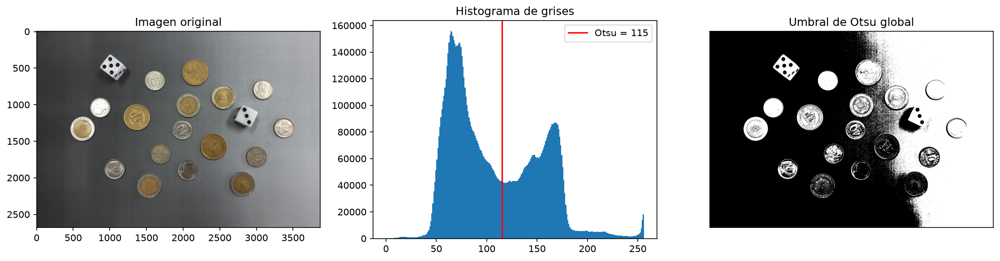
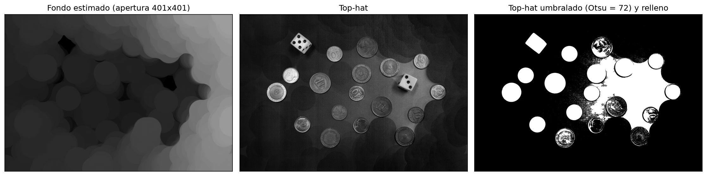
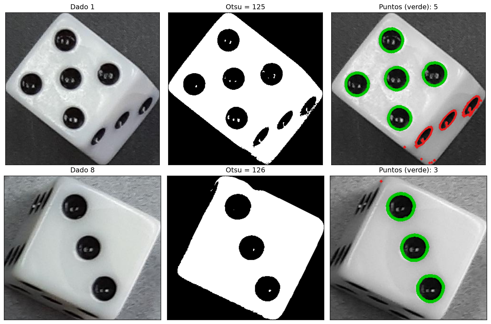
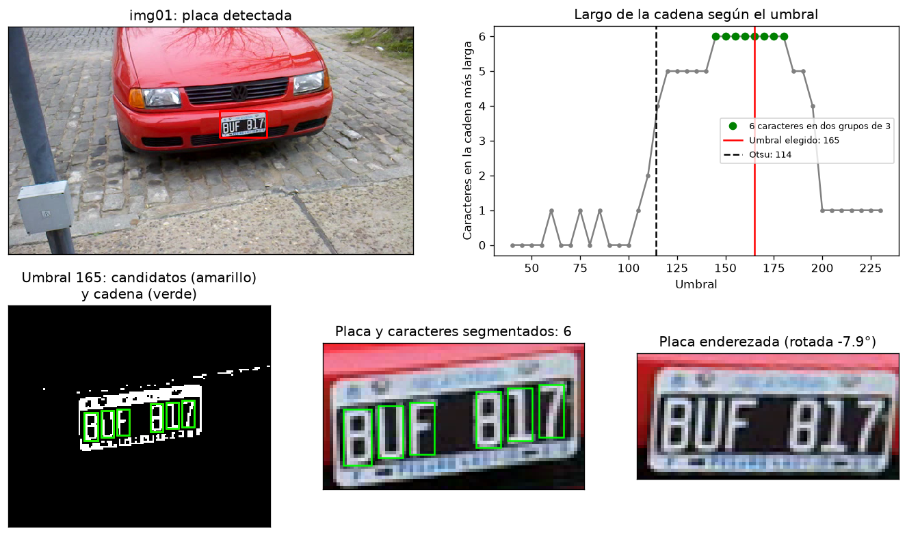
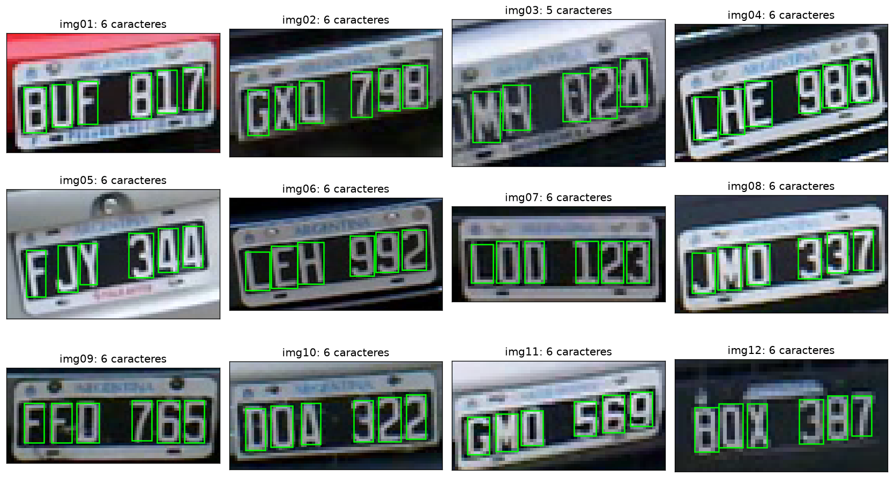
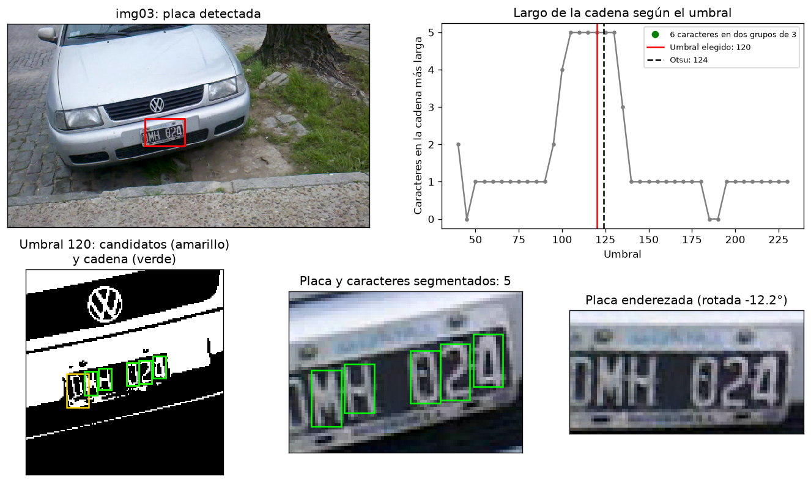

## Problema 1: Detección y clasificación de monedas y dados

### Descripción del problema

La imagen `monedas.jpg` muestra monedas de distinto valor y tamaño y dos dados sobre un tapete de intensidad no uniforme. La consigna pide:

- **A)** Segmentar automáticamente las monedas y los dados.
- **B)** Clasificar los distintos tipos de monedas y contarlas.
- **C)** Determinar el valor de la cara superior de cada dado y contarlos.

La solución está en `src/problema1_monedas_dados.py`. El script muestra cada etapa en pantalla, imprime sus resultados y guarda las figuras en `resultados/problema1/`.

### Análisis de la imagen

Antes de segmentar, el script mide el nivel de gris del tapete en los dos bordes de la imagen, donde no hay objetos, y prueba un umbral global con el método de Otsu (Unidad 3):

```text
Tamaño: 3871 x 2681 píxeles
Gris medio de las 100 columnas de la izquierda: 52
Gris medio de las 100 columnas de la derecha: 171
Umbral de Otsu sobre toda la imagen: 115
```

El tapete pasa de un gris medio de 52 a la izquierda a 171 a la derecha. Por eso el histograma de la Figura 1 tiene dos picos, que no son el fondo y los objetos sino las dos mitades del tapete. Otsu pone el umbral entre ellos, en 115, y la máscara resultante separa la mitad derecha del tapete de la izquierda. Las monedas de la derecha, además, quedan más oscuras que su fondo: en la máscara se ven negras sobre blanco.



Un umbral único no sirve: el mismo nivel de gris es fondo de un lado de la imagen y moneda del otro.

### Intento con top-hat

El apunte de la Unidad 6 propone, para estos casos, obtener un fondo uniforme restándole a la imagen su apertura con un elemento estructural más grande que los objetos: la transformación top-hat. El apunte de la Unidad 3 usa la misma idea como umbral local. Se usó una elipse de 401×401 píxeles, más grande que la moneda más grande: su área, de 103 016 píxeles según la tabla de la sección 1.5, equivale a un círculo de unos 362 píxeles de diámetro. Después, el top-hat se umbraliza con Otsu y se rellenan los huecos:

```text
Top-hat: umbral de Otsu 72, 5763 regiones
Top-hat: la región más grande tiene 1065620 píxeles
```

En esta imagen el top-hat no alcanza (Figura 2):

- **El fondo estimado no es suave.** Donde las monedas están cerca, la elipse no entra entre ellas sin tocar zonas más oscuras, y la apertura queda por debajo del tapete real. El centro del tapete conserva brillo en el top-hat y, al umbralizar, se une con las monedas: la región más grande mide 1 065 620 píxeles, diez veces una moneda grande.
- **El top-hat solo resalta lo que es más claro que el fondo.** Las monedas que son más oscuras que el tapete, como las de la derecha, quedan apenas marcadas por su borde.



El problema no es solo el gradiente del fondo: hay monedas con un nivel de gris parecido al del tapete que las rodea. Lo que las separa siempre es el borde, así que la segmentación se hizo a partir de los bordes.

### Segmentación por bordes (ítem A)

**Bordes.** Se suaviza la imagen con un filtro gaussiano de desvío 2 y se aplica Canny (Unidad 3) con umbrales 20 y 60. Canny responde a los cambios locales de intensidad, no al nivel absoluto, así que el gradiente lento del tapete no genera bordes. La textura del tapete sí genera muchos tramos cortos. Cada tramo es una componente conectada de la imagen de bordes, y se descartan los de menos de 50 píxeles:

```text
Canny: 3586 tramos de borde, 936 de 50 píxeles o más
```

La Figura 3 muestra el efecto en la zona central, donde el tapete tiene más textura: los contornos de las monedas y los dados se mantienen y desaparecen los tramos sueltos del tapete. Si se dejaran, la dilatación del paso siguiente los engordaría y podrían unir monedas vecinas.


**Máscara.** Los contornos de Canny tienen cortes, así que no se pueden rellenar directamente. Se aplica la secuencia de la Figura 4, con las herramientas de la Unidad 6:

1. **Dilatación** con una elipse de 35×35, que cierra los cortes de los contornos.
2. **Relleno de huecos** con la función `imfillhole_v2` de la Unidad 6: se inunda el fondo desde una esquina con `cv2.floodFill`, y lo que no se inunda queda dentro de un contorno cerrado.
3. **Erosión** con la misma elipse, que devuelve a los objetos el tamaño que tenían antes de la dilatación.
4. **Apertura** con una elipse de 41×41, que elimina los restos chicos y alisa el borde de los objetos.

```text
Regiones después de la erosión: 23
Regiones después de la apertura: 19
```

La apertura elimina cuatro regiones chicas, y quedan 19 objetos. Los umbrales de Canny y los tamaños de los elementos estructurales se eligieron probando sobre la imagen. Con umbrales más altos o un elemento de cierre más chico, algunos contornos quedan abiertos y el relleno no completa la moneda; con un elemento de cierre más grande, se unen monedas vecinas.


### Monedas y dados (ítem A)

Para separar monedas de dados se usa el factor de forma de la pista de la cátedra, multiplicado por $4\pi$ para que un círculo dé 1:

$$
\rho = \frac{4 \pi A}{P^2}
$$

donde $A$ es el área del contorno externo del objeto (`cv2.contourArea`) y $P$ su perímetro (`cv2.arcLength`). Los objetos se numeran de arriba hacia abajo:

```text
Objeto  Área (px)  Rho    Clase
     1      72020  0.778  dado
     2     103016  0.876  moneda
     3      59954  0.881  moneda
     4      61522  0.868  moneda
     5      87700  0.861  moneda
     6      84432  0.875  moneda
     7      58230  0.896  moneda
     8      62638  0.720  dado
     9     102796  0.866  moneda
    10      60859  0.873  moneda
    11      86090  0.892  moneda
    12      58726  0.850  moneda
    13     101714  0.842  moneda
    14      60166  0.886  moneda
    15      61962  0.859  moneda
    16      60479  0.885  moneda
    17      58434  0.885  moneda
    18      87098  0.832  moneda
    19      87332  0.890  moneda
Monedas: 17, dados: 2
```

Las monedas dan entre 0,832 y 0,896, y los dados, 0,720 y 0,778. Ninguna moneda llega a 1 por dos motivos: el contorno sigue el borde de los píxeles en escalones, así que `cv2.arcLength` mide un perímetro más largo que el de la circunferencia real, y el borde de la máscara tiene pequeñas irregularidades (Figura 4). Con un rango de 0,9 a 1,1 para los círculos, todas las monedas quedarían como no circulares. Por eso el umbral se eligió con los valores medidos: un objeto con $\rho < 0{,}8$ es un dado. Ese valor queda entre el dado de mayor $\rho$ y la moneda de menor $\rho$, y separa los 17 círculos de los 2 cuadrados (Figura 5).


### Tipos de moneda (ítem B)

Las monedas de distinto valor tienen distinto tamaño, así que se clasifican por área. El script las ordena de menor a mayor y calcula cuánto mayor es cada una que la anterior:

```text
Moneda  Área (px)  Área / anterior
     7      58230
    17      58434  1.004
    12      58726  1.005
     3      59954  1.021
    14      60166  1.004
    16      60479  1.005
    10      60859  1.006
     4      61522  1.011
    15      61962  1.007
     6      84432  1.363
    11      86090  1.020
    18      87098  1.012
    19      87332  1.003
     5      87700  1.004
    13     101714  1.160
     9     102796  1.011
     2     103016  1.002
```

Entre monedas consecutivas el área crece como mucho un 2,1 %, salvo en dos saltos: 36,3 % y 16,0 %. Se toma como criterio que una moneda más de un 10 % mayor que la anterior empieza un tipo nuevo, y así quedan tres grupos (Figura 6). El nombre de cada grupo sale de lo que se lee en sus monedas: «10 CENTAVOS» en las monedas 3, 12 y 15, «UN PESO» en las bimetálicas (por ejemplo, la 11) y un «50», gastado, en la moneda 2.

```text
Conteo de monedas:
  10 centavos: 9 (áreas de 58230 a 61962 px)
  1 peso: 5 (áreas de 84432 a 87700 px)
  50 centavos: 3 (áreas de 101714 a 103016 px)
```


### Valor de los dados (ítem C)

Los puntos de un dado son huecos oscuros dentro de su cara blanca. Para cada dado:

1. Se recorta su rectángulo envolvente y se umbraliza el recorte con Otsu, que separa la cara blanca de lo oscuro.
2. Se conserva solo lo que está dentro de la máscara del dado, porque en el lado derecho de la imagen el tapete también supera el umbral.
3. Se buscan los contornos con `cv2.RETR_CCOMP`, que organiza la jerarquía en dos niveles: los contornos que tienen un contorno padre son huecos.

```text
Dado 1: umbral de Otsu 125, 20 huecos
  Los 10 huecos más grandes, en % del área del dado: 3.14, 3.10, 3.07, 3.07, 3.04, 1.26, 1.20, 1.16, 0.01, 0.01
  Valor: 5

Dado 8: umbral de Otsu 126, 4 huecos
  Los 10 huecos más grandes, en % del área del dado: 3.88, 3.67, 3.61, 0.00
  Valor: 3
```

No todos los huecos son puntos de la cara superior:

- **Puntos de la cara superior:** ocupan entre 3,04 % y 3,88 % del área del dado.
- **Puntos de la cara lateral del dado 1:** entre 1,16 % y 1,26 %. Se ven de costado, achatados, y por eso ocupan menos de la mitad. En el dado 8, las caras laterales quedan oscuras en la binarización, así que sus puntos no forman huecos.
- **El resto:** como mucho 0,01 %. Son reflejos y ruido de la binarización.

Se cuentan como puntos los huecos que ocupan más del 2 % del área del dado. El dado 1 vale 5 y el dado 8 vale 3 (Figura 7).



### Resultado y conclusiones

```text
Resultado: 17 monedas y 2 dados con valores 5, 3
```

La Figura 8 resume los tres ítems: 9 monedas de 10 centavos, 5 de 1 peso, 3 de 50 centavos, y dos dados que valen 5 y 3.


Las principales dificultades fueron tres. La primera, el fondo: su gradiente impide umbralar la imagen directamente, y el top-hat no lo resuelve en esta imagen porque las monedas están cerca entre sí y algunas son más oscuras que el tapete. La segunda, los contornos de Canny, que tienen cortes y hay que cerrarlos sin unir monedas vecinas. La tercera, los puntos de las caras laterales de los dados, que también son huecos y se distinguen por su área.

La segmentación por bordes resuelve el problema del fondo, porque los bordes no dependen del nivel de gris absoluto, y la morfología los convierte en una máscara con un objeto por moneda o dado. Con esa máscara, el factor de forma separa monedas de dados, y el área separa los tres tipos de moneda con saltos de al menos 16 %, contra un 2,1 % como máximo dentro de cada tipo. En los dados, el área de cada hueco distingue los puntos de la cara superior de los de las caras laterales.

Los umbrales de Canny y los elementos estructurales se ajustaron para esta imagen. Con otra escala o iluminación habría que revisarlos, aunque los criterios de clasificación (factor de forma, saltos de área y área relativa de los puntos) son proporciones y no dependen del tamaño de la imagen.

## Problema 2: Detección y segmentación de patentes

### Descripción del problema

Las doce imágenes `img01.png` a `img12.png`, de 640×360 píxeles, muestran la parte delantera o trasera de distintos vehículos con su patente. La consigna pide, para cada una:

- **A)** Detectar automáticamente la placa patente y segmentarla.
- **B)** Segmentar los caracteres de la placa detectada.

La solución está en `src/problema2_patentes.py`. Primero busca los caracteres y después, a partir de ellos, la placa. Para cada imagen muestra en pantalla y guarda en `resultados/problema2/` una figura con las etapas, y al final una figura con las doce placas.

### Lo que se sabe de una patente

Las placas tienen caracteres blancos sobre fondo negro, rodeados por un marco blanco. La pista de la cátedra (`info_patentes.txt`) agrega tres datos, que son la base del método:

- La relación alto/ancho de un carácter está entre 1,5 y 3.
- Los caracteres forman grupos de a 3.
- La patente tiene dos grupos de 3 caracteres.

En una imagen umbralizada hay cientos de componentes. Pocas tienen forma de carácter, y casi nunca hay seis seguidas, alineadas y de la misma altura, salvo en la patente.

### Candidatos a carácter

Para un umbral dado, la imagen en grises se binariza (blanco lo que supera el umbral) y se buscan las componentes conectadas con `cv2.connectedComponentsWithStats` (Unidad 3). Son candidatos a carácter las que cumplen:

- **Alto entre 8 y 40 píxeles.** Es un rango amplio alrededor de lo que miden los caracteres en estas imágenes: según la salida del script, su alto mediano va de 11 a 20 píxeles.
- **Relación alto/ancho entre 1,5 y 3**, la de la pista.
- **Área de 15 píxeles o más**, para descartar manchas sueltas.

### Cadena de caracteres

Entre los candidatos, ordenados de izquierda a derecha, se busca la cadena más larga en la que cada carácter cumple, respecto del anterior:

- **Alto parecido:** difiere del alto del primero de la cadena en menos del 30 %.
- **Alineado:** su centro vertical está a menos de 0,4 altos del centro del anterior. Esto tolera las placas un poco inclinadas.
- **Cerca:** empieza después de la mitad del anterior, y el espacio entre los dos es de 1,5 altos como mucho.

Una cadena es una patente válida si tiene 6 caracteres y el espacio más grande está entre el tercero y el cuarto: los dos grupos de 3 de la pista.

### Elección del umbral

Un único umbral no alcanza. Con el de Otsu (Unidad 3), la cadena es una patente válida en 6 de las 12 imágenes. En la imagen 1, por ejemplo, Otsu da 114 y la cadena más larga tiene 4 caracteres:

```text
img01
  Umbrales con 6 caracteres en dos grupos de 3: 8, de 145 a 180
  Umbral de Otsu: 114, cadena más larga: 4 (no es una patente válida)
  Umbral elegido: 165, caracteres: 6, alto mediano: 15 px
  Espacios entre caracteres (px): [2, 2, 12, 2, 2]
  Placa (x, y, ancho, alto): (334, 133, 75, 42)
```

Por eso el script prueba todos los umbrales de 40 a 230, de 5 en 5, y con cada uno busca la cadena más larga. La Figura 9 muestra el resultado para la imagen 1. Con umbrales bajos, los caracteres quedan pegados al marco blanco de la placa y forman una sola componente. Con umbrales altos, sus trazos se cortan. Entre los dos extremos hay un rango de umbrales, de 145 a 180 en esta imagen, en el que aparecen los 6 caracteres en dos grupos de 3. Se elige el umbral del medio de ese rango, el más alejado de los dos problemas. Si ningún umbral da una patente válida, se usa el del medio entre los que dan la cadena más larga.



El rango de umbrales válidos cambia mucho de una imagen a otra, porque cada foto tiene otra iluminación y otro contraste (tabla de la sección 2.7). El de la imagen 1 (145 a 180) y el de la imagen 2 (90 a 120) ni siquiera se tocan, así que no hay un umbral fijo que sirva para todas.

### Placa (ítem A) y caracteres (ítem B)

Los caracteres de la cadena elegida son la segmentación del ítem B. La placa se obtiene a partir de ellos: es el rectángulo que los contiene, agrandado en proporción al alto mediano de los caracteres para incluir el marco y la inscripción superior. Se agranda 0,4 altos a cada lado, 0,8 arriba y 0,5 abajo. Los márgenes se eligieron mirando las doce placas. La caja no se rota para seguir la inclinación de la placa: al presentar el TP, la cátedra aclaró que no hace falta.



Además, el script muestra cada placa enderezada (Figura 11). La inclinación sale de la recta que mejor ajusta las bases de los caracteres, calculada con `np.polyfit`. Después, la imagen se rota ese ángulo alrededor del centro de la placa con `cv2.getRotationMatrix2D` y `cv2.warpAffine` (Unidad 4). Las esquinas de los caracteres se llevan a la imagen rotada con `cv2.transform`, y la placa se recorta con los mismos márgenes que antes. Las placas están inclinadas hasta 14,1° (imagen 4). Enderezarlas no cambia la detección, porque se hace después de encontrar los caracteres. La cadena, por su parte, ya admite placas inclinadas: la imagen 4, la más inclinada, sale completa.


### Resultados

Al final, el script imprime el resumen de las doce imágenes:

```text
Placas con los 6 caracteres segmentados: 11 de 12
Con un único umbral (Otsu) habrían sido: 6 de 12
```

La tabla siguiente junta, para cada imagen, lo que imprime el script:

| Imagen | Umbrales válidos | Umbral elegido | Otsu (caracteres en la cadena) | Espacio entre grupos (px) | Inclinación |
|:--|:--|--:|:--|--:|--:|
| img01 | 8, de 145 a 180 | 165 | 114 (4) | 12 | −7,9° |
| img02 | 7, de 90 a 120 | 105 | 116 (6) | 9 | −9,7° |
| img03 | ninguno | 120 | 124 (5) | no aplica | −12,2° |
| img04 | 15, de 125 a 195 | 160 | 115 (2) | 10 | −14,1° |
| img05 | 17, de 110 a 190 | 150 | 118 (6) | 13 | −10,5° |
| img06 | 12, de 55 a 120 | 95 | 102 (6) | 13 | −7,9° |
| img07 | 10, de 75 a 120 | 100 | 107 (6) | 10 | 0,0° |
| img08 | 13, de 130 a 190 | 160 | 119 (2) | 10 | −8,3° |
| img09 | 9, de 80 a 120 | 100 | 134 (4) | 13 | −0,2° |
| img10 | 6, de 115 a 140 | 130 | 122 (6) | 12 | −3,6° |
| img11 | 4, de 135 a 150 | 145 | 112 (1) | 10 | −9,9° |
| img12 | 7, de 80 a 110 | 95 | 92 (6) | 8 | −5,3° |

En las 11 placas completas, el espacio entre los dos grupos mide entre 8 y 13 píxeles. Los espacios entre caracteres del mismo grupo miden entre 0 y 5. En la imagen 6, los umbrales válidos no son continuos: hay 12 entre 55 y 120, con un hueco en el medio.

**La imagen 3** es la única incompleta: se segmentan 5 caracteres y falta la «D». La Figura 12 muestra por qué. La placa está inclinada y la «D» toca el marco. Con el umbral elegido, las dos forman un solo candidato (en amarillo), más alto que los demás caracteres, que queda fuera de la cadena por la condición de alto parecido. Con umbrales más altos, el trazo de la «D» se corta antes de separarse del marco, así que ningún umbral da 6 caracteres. Como la placa se arma a partir de los caracteres, su caja deja afuera el extremo izquierdo.



Las figuras de las demás imágenes están en `resultados/problema2/`.

### Dificultades y conclusiones

Las principales dificultades fueron:

- **El umbral:** cada imagen tiene otra iluminación, y el rango de umbrales que separa los caracteres cambia de una a otra.
- **El marco de la placa:** con umbrales bajos se pega a los caracteres, y en la imagen 3 ningún umbral separa la «D» del marco sin cortarla.
- **Los trazos finos:** los caracteres miden entre 11 y 20 píxeles de alto, y sus trazos tienen muy pocos píxeles de ancho. Una apertura para despegarlos del marco los rompe, así que se descartó.
- **El resto de la imagen:** rejas, paragolpes, adoquines y reflejos generan muchas componentes con forma de carácter.

Lo que resuelve el problema son las pistas de la cátedra. La relación alto/ancho deja pocos candidatos, y la condición de seis caracteres alineados en dos grupos de 3 aparece solo en la patente. Probar todos los umbrales en lugar de usar uno solo adapta el método a cada imagen: con Otsu habrían sido 6 placas completas de 12, y con el barrido son 11. Las doce placas quedan ubicadas, aunque en la imagen 3 la caja no incluye el extremo izquierdo.

El método tiene límites. La caja de la placa sale de márgenes fijos alrededor de los caracteres, no de los bordes reales de la placa. El rango de altos y las tolerancias están pensados para patentes de este tamaño en la imagen. Y si ningún umbral separa un carácter del marco sin cortarlo, como en la imagen 3, la cadena queda incompleta.
